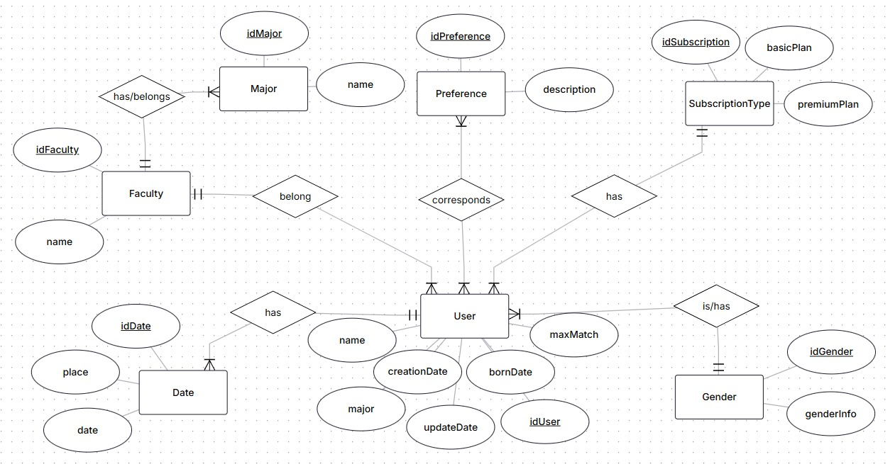
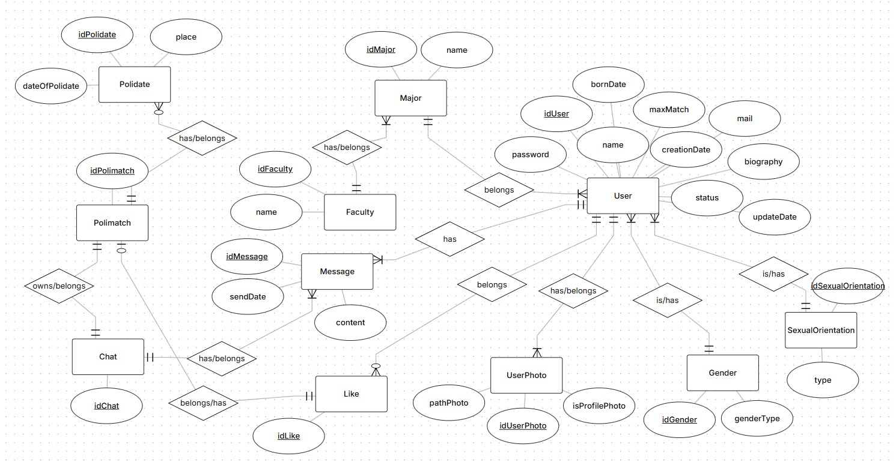
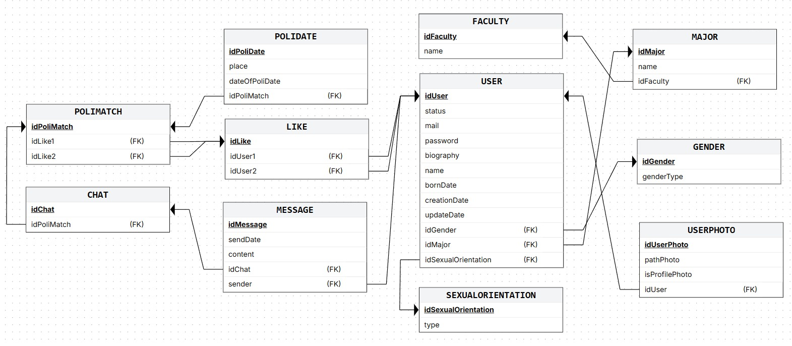

# Modelo de datos y uso de tablas

El ER físico vigente tiene once tablas. Se incorporó SEXUALORIENTATION y USER.idSexualOrientation. No se infiere el valor de personas existentes: el catálogo incluye «Prefiero no indicarlo».

| Tabla | PK | Interacción directa o indirecta | Código |
|---|---|---|---|
| FACULTY | idFaculty | Selector de facultad y filtros de carrera; JOIN en reportes. | ProfileView / PeopleService.choices |
| MAJOR | idMajor | Registro y edición del perfil; carrera visible y reportes. | ProfileView / PeopleService |
| GENDER | idGender | Selección en perfil, filtro Descubrir y consulta con JOIN. | ProfileView / DiscoverView / PeopleService |
| SEXUALORIENTATION | idSexualOrientation | Selección, persistencia y recuperación del valor elegido. | ProfileView / PeopleService / Models.User |
| USER | idUser | Registro, login, edición y descubrimiento. | PeopleService |
| USERPHOTO | idUserPhoto | Subida, lectura, portada y eliminación de fotos. | PhotoService / ProfileView / DiscoverView |
| LIKE | idLike | Like dirigido y búsqueda de reciprocidad. | PeopleService.like |
| POLIMATCH | idPoliMatch | Creación por likes recíprocos y listado de parejas. | PeopleService.like / matches |
| CHAT | idChat | Conversación única del match. | PeopleService.like / ChatService |
| MESSAGE | idMessage | Envío y lectura de mensajes. | ChatService.send / messages |
| POLIDATE | idPoliDate | Agenda, consulta y control de conflictos. | ChatService.schedule / ChatViews |

## Relaciones

- FACULTY 1:N MAJOR; MAJOR 1:N USER.
- GENDER y SEXUALORIENTATION tienen cada una una relación 1:N con USER.
- USER 1:N USERPHOTO.
- LIKE tiene dos FK a USER: emisor y receptor. Representa una relación N:N dirigida entre personas.
- POLIMATCH referencia dos filas de LIKE, mediante idLike1 e idLike2. Java comprueba la reciprocidad. La imagen conceptual simplifica esta relación; no debe interpretarse como un único like por match.
- POLIMATCH 1:0..1 CHAT por UNIQUE en SQL. La app crea ambos juntos, por lo que el flujo normal es 1:1.
- CHAT 1:N MESSAGE y USER 1:N MESSAGE mediante sender.
- POLIMATCH 1:N POLIDATE. Un match puede tener varias citas, no al revés.

Las PK, FK, UNIQUE y CHECK validan integridad estructural. Java valida reciprocidad, participantes del chat y ausencia de citas en el mismo minuto para cualquiera de los participantes. Una cita pasada no prueba asistencia.

## Comparación de los tres diagramas

### MER V1

Diseño histórico: preferencias y planes no forman parte del esquema vigente.

### MER mejorado

Añade interacciones, fotos y orientación. El atributo conceptual maxMatch no aparece en el ER físico aportado y no se añade un límite sin una regla de negocio definida.

### ER físico implementado

Es la referencia para las once tablas y sus atributos. Los diagramas originales se conservan sin retocarlos. Las diferencias de cardinalidad se explican en texto.
