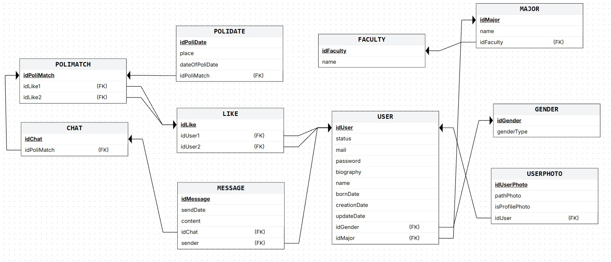

# Diagrama de PoliTinder

La imagen `PoliTinder_ER_original.jpg` es una copia sin modificaciones de la última versión del ER proporcionada por el usuario. El DDL conserva sus diez tablas y sus columnas.

## Entidades y propósito

| Tabla | Clave primaria | Qué representa |
|---|---|---|
| FACULTY | idFaculty | Facultad a la que pertenecen las carreras. |
| MAJOR | idMajor | Carrera, con idFaculty como clave foránea. |
| GENDER | idGender | Catálogo de géneros. |
| USER | idUser | Cuenta, perfil, nacimiento, estado, género y carrera. |
| USERPHOTO | idUserPhoto | Ruta de una fotografía y su propietario. |
| LIKE | idLike | Interés dirigido desde idUser1 hacia idUser2. |
| POLIMATCH | idPoliMatch | Pareja formada por dos likes recíprocos. |
| CHAT | idChat | Conversación asociada a un match. |
| MESSAGE | idMessage | Mensaje de un emisor dentro de un chat. |
| POLIDATE | idPoliDate | Cita con lugar y fecha asociada a un match. |

## Relaciones

- **FACULTY 1:N MAJOR:** una facultad puede tener varias carreras; cada carrera pertenece a una facultad.
- **MAJOR 1:N USER:** cada usuario tiene una carrera; una carrera puede tener varios usuarios.
- **GENDER 1:N USER:** cada usuario referencia un género del catálogo.
- **USER 1:N USERPHOTO:** un usuario puede tener varias fotos. La clave foránea está en USERPHOTO. La carga de prueba tiene al menos dos por usuario; el DDL permite cero o más.
- **USER y LIKE:** hay dos relaciones 1:N con roles diferentes: quien envía y quien recibe. En conjunto representan el interés N:N dirigido entre usuarios. La tabla intermedia tiene su propio idLike y las dos claves foráneas.
- **POLIMATCH y LIKE:** idLike1 e idLike2 referencian dos filas de LIKE. La regla de negocio exige que sus direcciones sean opuestas.
- **POLIMATCH 1:0..1 CHAT:** el DDL permite que un match todavía no tenga chat, pero impide más de uno mediante UNIQUE(idPoliMatch). La app crea ambos dentro de la misma transacción.
- **CHAT 1:N MESSAGE:** un chat puede comenzar vacío y después contener muchos mensajes. Cada mensaje pertenece a un chat.
- **USER 1:N MESSAGE:** sender identifica a la persona que escribió cada mensaje.
- **POLIMATCH 1:N POLIDATE:** una pareja puede agendar varias citas; cada cita pertenece a un match.

## Ejemplo de reciprocidad

Si el usuario A tiene ID 1 y B tiene ID 2:

| idLike | idUser1 | idUser2 |
|---|---|---|
| 1 | 1 | 2 |
| 2 | 2 | 1 |

POLIMATCH puede almacenar `(idPoliMatch=1, idLike1=1, idLike2=2)` y CHAT puede almacenar `(idChat=1, idPoliMatch=1)`. Si falta cualquiera de los likes, la aplicación no crea el match ni el chat.

## Qué valida MySQL y qué valida Java

El DDL valida claves primarias, referencias existentes, correos y rutas de fotos únicos, ausencia de autolikes, direcciones de like únicas, orden de IDs de likes y un chat por match.

Java comprueba que los likes sean recíprocos, que quien envía un mensaje participe en el chat, que la persona sea adulta y que solo exista una foto principal por perfil. También comprueba que ninguno de los participantes tenga otra PoliDate en el mismo minuto, incluso con otra pareja; parejas sin participantes compartidos sí pueden usar ese horario. Las operaciones sensibles usan transacciones y bloqueos para evitar duplicados simultáneos.

Las consultas SQL introducidas manualmente pueden saltarse las reglas que solo aplica Java. Las claves foráneas no prueban, por sí solas, que dos likes sean recíprocos o que el emisor participe en el chat.

## Fotos, fechas y límites del modelo

`pathPhoto` guarda una ruta relativa al proyecto; el archivo de imagen permanece en `photos/`. `password` almacena un hash PBKDF2 con sal, nunca la contraseña en texto plano. La edad se calcula a partir de `bornDate`.

El modelo no contiene una fecha de creación del match, confirmación de asistencia a citas, duración de las citas ni suscripciones. Los reportes no pueden deducir esos datos. El reporte de citas pasadas compara fechas y aclara que eso no confirma asistencia.

## Archivos relacionados

- `sql/01_ddl.sql`: definición del esquema.
- `sql/02_dml.sql`: carga inicial de 30 usuarios, 70 fotos y relaciones de ejemplo.
- `sql/03_reportes.sql`: mismas nueve consultas que utiliza la app.
- `sql/04_ampliar_demo.sql`: ampliación de una base existente sin recrearla.
- `sql/EXPLICACION_DML.txt`: explicación de las inserciones y funciones SQL.
- `CUENTAS_PRUEBA.txt`: seis accesos para la demostración.
